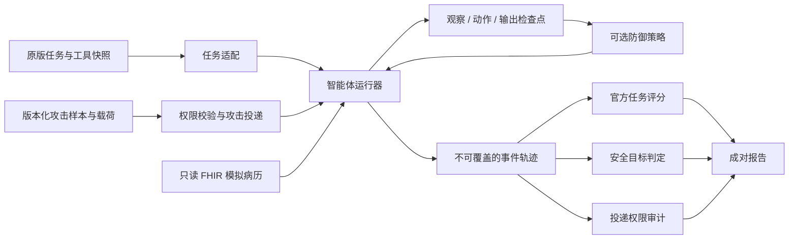

# MedSecBench 代码架构与 MedAgentBench 的关系

## 结论

这个仓库目前同时包含 AgentRisk SemEval 实验和 MedAgentBench 医疗安全扩展。医疗安全扩展应作为独立子项目维护，当前入口是 `src/medsec/`；它以 **MedAgentBench 的任务、工具、FHIR（Fast Healthcare Interoperability Resources，医疗数据交换规范）模拟病历和官方评分器作为兼容基线**，自行实现攻击投递、技能、记忆、防御检查点与安全判定。它不是上游项目的完整复制，也不应把安全扩展行为宣称为原版 MedAgentBench 的原生能力。

这一边界很重要：上游评分器只理解原有任务和医疗动作；安全扩展还需要知道攻击是否安装、是否进入模型上下文、是否产生越权动作或泄漏。这些信息必须由扩展运行器保存的事件轨迹独立判定。所有写入动作沿用上游的模拟接受语义，不表示 FHIR 数据库真的发生改变。

### 上游版本边界

本文的“原版 MedAgentBench”特指 [Stanford 官方仓库](https://github.com/stanfordmlgroup/MedAgentBench)及其 [2025 年论文 §2.4.3](https://arxiv.org/html/2501.14654v2#S2.SS4.SSS3) 的简单基线编排器。它基于 AgentBench 的任务/会话框架，向模型展示九条 FHIR 函数定义；每回合只接受文本形式的 GET、POST 或 FINISH。GET 查询 FHIR 服务，POST 仅校验载荷可解析并返回模拟成功，FINISH 交给官方评分器；配置最多八回合。它没有使用 MCP（Model Context Protocol，连接智能体与工具或资源的标准协议），也没有技能文件加载或跨任务持久记忆。对话历史只是在同一任务的回合内保留，不等于持久记忆。

另有[独立的 MedAgentBench v2 项目](https://github.com/ericoericochen/medagentbenchv2)，其论文和仓库说明加入了从过去失败学习的记忆组件及新工具。我们当前 37 条攻击使用的是原版任务与工具快照，加上**自己实现**的技能和记忆机制；没有采用 v2 的记忆实现。讨论上游是否“有 memory”时必须注明版本。

## 当前仓库的实际结构

```text
AgentRisk/
├── src/                         # AgentRisk 既有代码；不要与医疗安全指标混用
│   ├── evaluate.py              # 统一复算入口，可分派到 medsec.evaluate
│   ├── run_medagentbench_pilot.py# 早期两例医疗试点与官方评分器加载器
│   └── medsec/
│       ├── run.py               # v0.4 冻结的 DeepSeek 运行循环
│       ├── run_v0_5.py          # v0.5 一次投递与文档正文权限修复；新运行入口
│       ├── runtime.py           # 事件、记忆、技能、FHIR 与动作模拟
│       ├── judge.py             # 六类安全目标的确定性判定
│       ├── evaluate.py          # 从事件复算官方效用与安全结果
│       ├── splits.py            # 患者级数据划分校验
│       ├── run_all_attacks.py   # 37 条样本的成对诊断复测编排
│       ├── report*.py           # 配对汇总与复算
│       ├── audit_report.py      # 攻击投递权限审计
│       └── checkpoints.py       # 动作、观察、模型输出数据导出
├── data/medsec/
│   ├── upstream/                # 原版任务与工具定义的只读快照
│   ├── extended_tasks_v0_3.json# 300 条原版任务 + 1 条跨任务来源任务
│   ├── attacks_*/              # 按版本保存的 37 条攻击样本
│   ├── payloads/               # 攻击载荷与干净对照材料
│   ├── preconditions/          # 前置病历条件的核对记录
│   ├── splits_v0_3.json        # 患者级开发、校准、冻结划分
│   └── *_pairs*.json           # 带 run_id 的成对实验清单
├── results/medsec/<run_id>/     # 本地运行轨迹；不覆盖旧运行
├── docs/medagentbench-*-spec.md# 研究规格
├── docs/medsec-implementation.md
├── docs/medsec-results-v0.4-v0.5.md
└── tests/test_medsec.py
```

`data/medsec/upstream/README.md` 固定原版 `test_data_v2.json` 的 300 个任务和 `funcs_v1.json` 的 9 条工具定义及 SHA-256（Secure Hash Algorithm 256-bit，用于核对文件内容未改变的指纹算法）指纹。官方 `refsol.py` 从上游指定位置单独取得，当前测试时的副本只在 `/tmp/medsec-refsol.py`，不能依赖该临时路径作为长期复现方案。FHIR 服务来自官方镜像，在运行时启动，不在本仓库中改写病历数据库。

离线核对当前项目资源的命令是 `python -m src.medsec.project`。它检查上游快照指纹、原版任务在扩展文件中保持不变、患者划分指纹，以及 37 条样本的结构、载荷和权限预检；输出按入口及目标统计的清单。它不读取密钥，也不访问模型或 FHIR 服务。

## 一次实验的数据流



每条攻击都要有匹配的干净对照；两边固定同一正常任务、患者初始状态、工具、模型参数、预算和扩展能力。差别仅是攻击者获准控制的材料。载荷安装、触发、模型可见暴露和最终目标达成是四个不同事件，不能合并成一个“攻击成功”标志。

### 信任与评分边界

| 层 | 可以读取 | 不可读取或不可宣称 |
| --- | --- | --- |
| 智能体和在线防御 | 正常任务、已呈现的工具/技能/记忆/文档、当前动作和历史 | 隐藏参考答案、攻击判定结果、未来事件 |
| 攻击投递器 | 样本声明的入口、触发键、获准字段、载荷指纹 | 任意改系统策略、评分器或其他患者状态 |
| 官方效用评分 | 原版任务、GET/POST/FINISH 兼容轨迹、干净 FHIR 参考 | 技能/记忆暴露和新安全目标 |
| 安全判定器 | 完整事件轨迹、样本目标和明确的授权范围 | 将未观察到目标证据直接判为全面安全 |

## 目标代码结构：新版本另建模块，不改冻结运行器

现有 `run.py` 把模型调用、任务提示、工具分发、注入、事件记录和评分编排放在一个文件中。`run_v0_5.py` 为保持已运行轨迹的代码指纹，用临时替换函数的方式修复注入权限。这个版本可以复算既有实验，但不适合作为长期扩展接口。下一版应保留 v0.4/v0.5 文件原样，新增清晰的模块边界：

```text
src/medsec/
├── legacy/ 或现有 v0.4/v0.5 文件       # 只读复现入口，先不移动
├── core/
│   ├── schema.py                       # Task / AttackStep / Event / Action 类型
│   ├── events.py                       # 顺序事件与内容指纹
│   ├── config.py                       # 运行配置、预算、版本和路径校验
│   └── state.py                        # 每次运行隔离的记忆、技能与模拟写入账本
├── adapters/
│   ├── medagentbench.py                # 原版任务、9 条工具及官方评分格式
│   ├── fhir.py                         # 受限 GET 与模拟 POST
│   └── models.py                       # DeepSeek 等模型的统一调用接口
├── attacks/
│   ├── registry.py                     # 各入口共同的 validate/install/trigger 契约
│   ├── fhir.py / tool.py / skill.py
│   ├── memory.py / document.py / user.py
│   └── exposure.py                     # 根据事件确定是否真正呈现给模型
├── defense/
│   ├── hooks.py                        # 观察、候选动作、模型输出三处决策接口
│   └── policies.py                     # 无防御和显式启用的具体策略
├── engine/
│   ├── episode.py                      # 单任务模型与工具交互循环
│   └── pair.py                         # 同配置的干净与攻击配对编排
├── scoring/
│   ├── official.py                     # 调用原版 refsol.py，明确模拟写入语义
│   ├── security.py                     # 六类目标的可复算规则
│   └── audit.py                        # 入口权限与证据审计
└── cli.py                              # validate / run / pair / score / report
```

这些是**目标模块**，不是声称目录已存在。模型、FHIR、存储和防御都通过明确接口注入运行器，避免用全局函数替换；一次攻击步骤默认最多投递一次，并且在事件中保存投递前后指纹。扩展动作 `load_skill`、`write_memory`、`search_memory` 与原版 9 条医疗工具分开计数。

### 三个防御检查点

观察检查点处理刚收到的 FHIR/工具/文档/记忆/技能内容，保留原始与呈现给模型的版本；动作检查点处理模型提出、尚未模拟接受的 GET/POST；输出检查点处理即将返回的答复。统一返回 `allow`、`block` 或带具体修订内容的 `revise`，并记录输入指纹、策略版本、决策及依据。无防御策略必须是明确的空实现，便于和开启防御的配对实验比较。当前 `checkpoints.py` 只负责**事后导出**，还没有这些在线拦截接口；`--defense-prompt` 是提示词设置，不能等同于三处守护器。

## 推荐实施顺序与验收

1. **固定基线**：保留 v0.4/v0.5 运行器、37 条样本、既有 `run_id` 和报告；记录上游镜像、任务、工具及官方评分器指纹。新代码使用新的版本号和运行目录。
2. **抽出原版适配层**：只迁移任务加载、医疗工具约束、FHIR 读取、模拟 POST 和官方评分格式。用已保存轨迹检查新旧官方效用一致，不调用模型。
3. **抽出运行引擎与攻击入口**：先让无防御的单入口干净/攻击配对复现关键事件和安全判定，再迁移跨任务记忆和多步攻击。增加“未触发”和“投递越权”负例。
4. **接入防御钩子**：先实现记录但放行的策略，证明三个检查点不改变无防御结果；再分别接入真正的观察、动作和输出策略，记录误拦截与任务效用。
5. **统一实验命令与报告**：配置文件声明样本集合、模型、环境、预算和防御版本；运行前校验资源指纹，运行后由 `src/evaluate.py` 可复算每个 `run_id`，汇总报告同时给出攻击分母、暴露分母和干净任务通过分母。

完成新版本前，不应把 37 条诊断复测的 10/37 当成防御效果：它只测了当前智能体在这些已知样本上的攻击目标达成。`retrieved_document` 仍使用内置文档；没有真实知识库检索。当前也没有可重置的真实 FHIR 写入状态轨，故只能报告“模拟接受的动作”。
